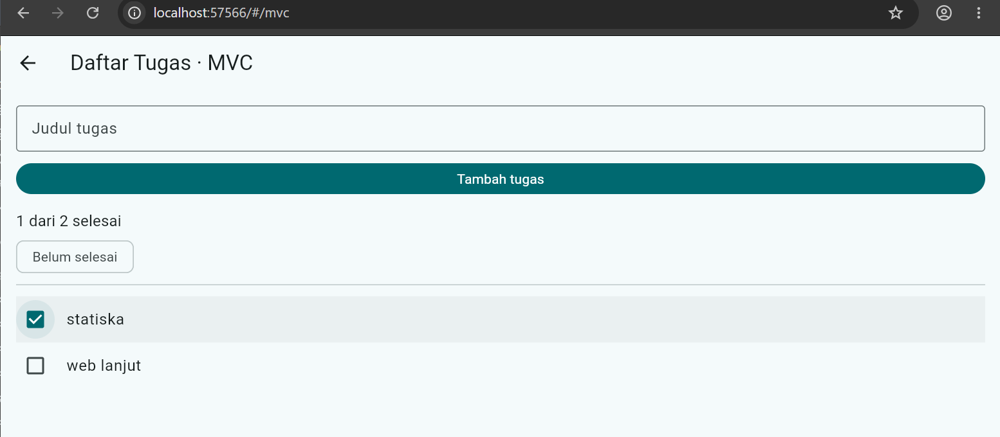
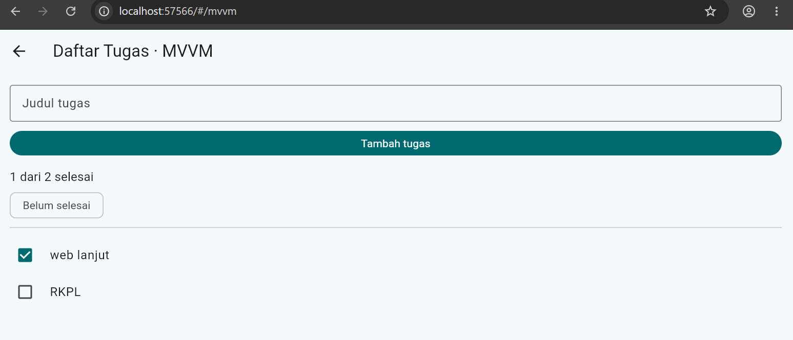
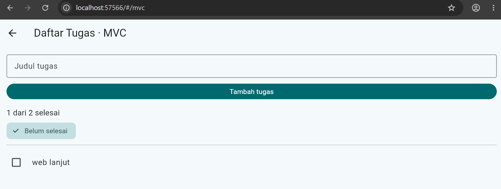
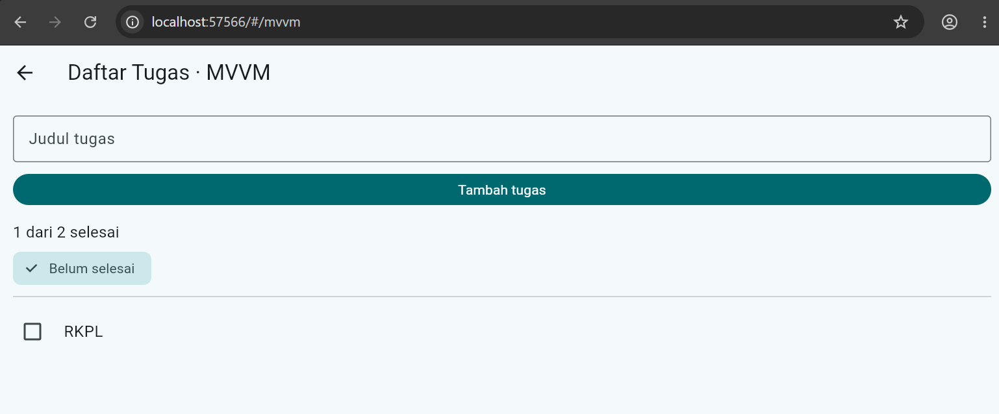
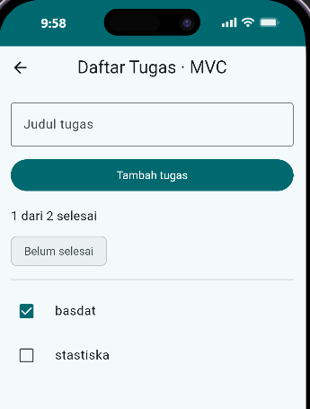
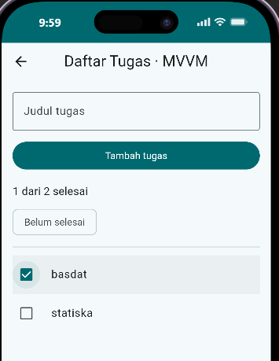
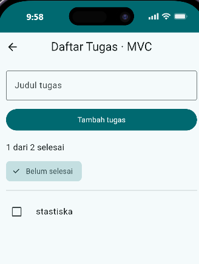
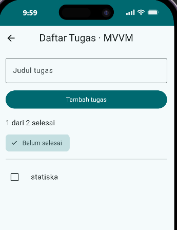
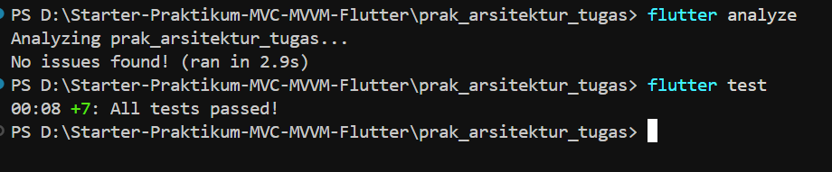

# Laporan Praktikum Mandiri: Arsitektur Aplikasi Flutter (MVC & MVVM) dan Pengujian

**Mata Kuliah:** Pemrograman Perangkat Bergerak  
**Program Studi:** D4 Teknologi Rekayasa Perangkat Lunak (TRPL) - Politeknik Negeri Banyuwangi  

---

## 1. Identitas Mahasiswa

| Informasi | Keterangan |
| :--- | :--- |
| **Nama Mahasiswa** | [Isi Nama Mahasiswa] |
| **NIM** | [Isi NIM Mahasiswa] |
| **Kelas / Semester** | [Isi Kelas / Semester] |
| **Tanggal Pelaksanaan** | 26 November 2026 |

---

## 2. Cara Menjalankan Aplikasi dan Pengujian

Aplikasi ini dikembangkan menggunakan Flutter SDK versi 3.29.2 dan dapat dijalankan pada target Web (Chrome), Desktop, maupun Mobile.

### A. Menyiapkan Dependensi
Jalankan perintah berikut pada terminal di dalam direktori `prak_arsitektur_tugas`:
```bash
flutter pub get
```

### B. Menjalankan Aplikasi
Untuk menjalankan aplikasi pada browser Google Chrome:
```bash
flutter run -d chrome
```

### C. Menjalankan Analisis Statis Kode
Untuk memverifikasi bahwa kode bersih dari *linter warnings* dan *errors*:
```bash
flutter analyze
```

### D. Menjalankan Seluruh Pengujian (*Testing*)
Untuk mengeksekusi semua berkas uji (smoke test, unit test logika, widget test layar, dan widget test filter):
```bash
flutter test
```

Untuk menjalankan berkas uji tertentu secara terpisah:
```bash
flutter test test/logika_test.dart
flutter test test/layar_test.dart
flutter test test/filter_test.dart
```

---

## 3. Tabel Perbandingan Arsitektur MVC dan MVVM

Berikut adalah analisis perbandingan implementasi fitur filter dan manajemen state pada kedua pendekatan arsitektur:

| Pertanyaan Evaluasi | Implementasi MVC | Implementasi MVVM |
| :--- | :--- | :--- |
| **Ketika filter diketuk, class mana yang menerima aksi dan menyimpan pilihan?** | - **Penerima Aksi UI:** Method `_ubahFilter(bool aktif)` pada class `_LayarMvcState`.<br>- **Penerima Aksi Logika & Penyimpan Pilihan:** Method `ubahFilter(bool aktif)` pada class `PengendaliTugas`. Pilihan disimpan pada variabel private `bool _hanyaBelumSelesai`. | - **Penerima Aksi UI & Logika:** Method `ubahFilter(bool aktif)` pada class `TugasViewModel`. Callback `onUbahFilter` pada `PanelTugas` langsung diteruskan ke method ini.<br>- **Penyimpan Pilihan:** Disimpan pada variabel private `bool _hanyaBelumSelesai` di dalam `TugasViewModel`, yang langsung memanggil `notifyListeners()`. |
| **Apa yang memicu rebuild? Apa akibatnya jika pemicu itu dihapus?** | - **Pemicu Rebuild:** Pemanggilan method `setState(() => _pengendali.ubahFilter(aktif))` dan `setState(() => _pengendali.ubahStatus(id))` di dalam class `_LayarMvcState`.<br>- **Akibat jika dihapus:** Nilai data di repositori/controller berubah, namun Flutter tidak menandai widget sebagai *dirty*. UI tidak merender ulang sehingga daftar tugas tidak tersaring dan teks ringkasan tidak berganti. Test `MVC memperbarui form dan ringkasan` gagal. | - **Pemicu Rebuild:** Pemanggilan method `notifyListeners()` di dalam `TugasViewModel`, yang didengarkan oleh widget `ListenableBuilder` pada `LayarMvvm`.<br>- **Akibat jika dihapus:** State internal ViewModel berubah, tetapi tidak ada sinyal notifikasi yang dikirimkan ke `ListenableBuilder`. UI tetap menampilkan kondisi lama. Test `MVVM memperbarui form dan ringkasan` gagal menemukan widget teks `"1 dari 1 selesai"`. |
| **Kapan Anda memilih masing-masing pola?** | - **Skenario Cocok:** Halaman sederhana dengan alur data satu arah atau form entri lokal yang tidak memiliki turunan state kompleks.<br>- **Kelebihan:** Struktur kode sederhana, alur eksekusi langsung (*straightforward*), dan tidak membutuhkan abstraksi listener tambahan.<br>- **Biaya / Risiko:** Pengembang harus secara manual memanggil `setState()` pada setiap aksi. Jika terlewat, UI tidak sinkron tanpa adanya peringatan compile-time. Logika UI mudah membengkak di berkas View. | - **Skenario Cocok:** Fitur dinamis dengan banyak ketergantungan state (misal filter data, penghitungan ringkasan selesai/total secara real-time, dan multi-komponen yang reaktif).<br>- **Kelebihan:** Pemisahan tanggung jawab sangat bersih (*separation of concerns*). State UI dan logika bisnis berada terpusat di ViewModel dan dapat diuji secara terisolasi tanpa memompa widget tree.<br>- **Biaya / Risiko:** Memerlukan pengelolaan siklus hidup (*lifecycle*) seperti keharusan memanggil `dispose()` pada ViewModel untuk mencegah *memory leak*, serta penulisan kode boilerplate awal (`ChangeNotifier` & `ListenableBuilder`). |

---

## 4. Hasil Pengujian dan Percobaan Deteksi Regresi

### A. Kondisi Normal (Seluruh Test Lulus)
Seluruh pengujian unit dan widget test berhasil dijalankan tanpa kendala (7 test lulus), serta analisis statis tidak menemukan pelanggaran aturan kode (*zero issues*):

```text
PS D:\Starter-Praktikum-MVC-MVVM-Flutter\prak_arsitektur_tugas> flutter analyze
Analyzing prak_arsitektur_tugas...
No issues found! (ran in 2.9s)

PS D:\Starter-Praktikum-MVC-MVVM-Flutter\prak_arsitektur_tugas> flutter test
00:00 +0: loading test/filter_test.dart
00:01 +1: MVC menyaring tugas belum selesai dengan benar
00:02 +2: MVVM menyaring tugas belum selesai dengan benar
00:03 +3: test/logika_test.dart: MVC menyimpan judul valid dan mengubah status
00:03 +4: test/logika_test.dart: MVVM memberi notifikasi setelah state berubah
00:04 +5: test/layar_test.dart: MVC memperbarui form dan ringkasan
00:05 +6: test/layar_test.dart: MVVM memperbarui form dan ringkasan
00:06 +7: test/smoke_test.dart: beranda membuka kedua implementasi
00:07 +7: All tests passed!
```

### B. Percobaan Deteksi Regresi (Pemicu Rebuild Dihapus Sementara)

#### 1. Penghapusan Pemicu pada MVVM
Pada `lib/mvvm/tugas_view_model.dart`, baris `notifyListeners()` pada method `ubahStatus()` dikomentari sementara:

```dart
void ubahStatus(int id) {
  _repo.ubahStatus(id);
  // notifyListeners();
}
```

**Hasil Keluaran Terminal:**
Pengujian mendeteksi regresi secara akurat karena `ListenableBuilder` tidak merebuild widget setelah status tugas berubah:

```text
00:01 +1: MVVM memperbarui form dan ringkasan
══╡ EXCEPTION CAUGHT BY FLUTTER TEST FRAMEWORK ╞════════════════════════════════════════════════════
The following TestFailure was thrown running a test:
Expected: exactly one matching candidate
  Actual: _TextWidgetFinder:<Found 0 widgets with text "1 dari 1 selesai": []>
   Which: means none were found but one was expected

When the exception was thrown, this was the stack:
#4      main.<anonymous closure> (file:///D:/Starter-Praktikum-MVC-MVVM-Flutter/prak_arsitektur_tugas/test/layar_test.dart:29:7)
...
This was caught by the test expectation on the following line:
  file:///D:/Starter-Praktikum-MVC-MVVM-Flutter/prak_arsitektur_tugas/test/layar_test.dart line 29
The test description was:
  MVVM memperbarui form dan ringkasan
════════════════════════════════════════════════════════════════════════════════════════════════════
00:02 +1 -1: MVVM memperbarui form dan ringkasan [E]
Failing tests:
  test/layar_test.dart: MVVM memperbarui form dan ringkasan
```

#### 2. Penghapusan Pemicu pada MVC
Pada `lib/mvc/layar_mvc.dart`, pemanggilan `setState` pada `_ubahStatus` dihilangkan menjadi pemanggilan langsung tanpa pembungkus:

```dart
void _ubahStatus(int id) {
  _pengendali.ubahStatus(id); // setState() dihapus
}
```

**Hasil Keluaran Terminal:**
Pengujian pada MVC mengalami kegagalan serupa karena teks ringkasan tidak diperbarui di layar:

```text
00:01 +0 -1: MVC memperbarui form dan ringkasan [E]
Expected: exactly one matching candidate
  Actual: _TextWidgetFinder:<Found 0 widgets with text "1 dari 1 selesai": []>
   Which: means none were found but one was expected
```

### C. Kondisi Setelah Pemicu Dipulihkan
Setelah baris `notifyListeners()` dan `setState()` dikembalikan ke posisi semula, kedua pengujian langsung lulus kembali 100%. Percobaan ini membuktikan bahwa pengujian otomatis mampu menangkal bug regresi sinkronisasi state UI sebelum kode masuk ke tahap rilis.

---

## 5. Bukti Tangkapan Layar Hasil Praktikum

Sesuai dengan ketentuan berkas pengumpulan pada panduan praktikum, berikut adalah dokumentasi visual hasil pengujian aplikasi:

### A. Tampilan Desktop Web

| Kondisi | Implementasi MVC | Implementasi MVVM |
| :---: | :---: | :---: |
| **Filter Mati**<br>*(Kedua tugas tampil, 1 selesai)* |  |  |
| **Filter Aktif**<br>*(Hanya tugas belum selesai tampil)* |  |  |

---

### B. Tampilan Mobile

| Kondisi | Implementasi MVC | Implementasi MVVM |
| :---: | :---: | :---: |
| **Filter Mati**<br>*(Kondisi awal 1 dari 2 selesai)* |  |  |
| **Filter Aktif**<br>*(Menyaring tugas selesai)* |  |  |

---

### C. Bukti Eksekusi Terminal

| Keterangan | Tangkapan Layar |
| :--- | :---: |
| **Hasil Eksekusi `flutter analyze` & `flutter test`**<br>*Analisis bersih tanpa issue dan seluruh 7 test sukses.* |  |

---

## 6. Kesimpulan

1. **Pola MVC:** Pembaruan antarmuka bergantung pada `setState()` yang dipanggil langsung di dalam View (`_LayarMvcState`) setelah delegasi ke `PengendaliTugas`. Pola ini cepat diimplementasikan untuk form sederhana, namun berisiko menimbulkan *silent regression* jika pengembang lupa memanggil `setState()` saat data berubah.
2. **Pola MVVM:** Pembaruan antarmuka berjalan reaktif menggunakan kontrak `ChangeNotifier` dan `ListenableBuilder`. `TugasViewModel` berperan sebagai penyedia tunggal state tampilan (`single source of truth`), memisahkan logika UI secara utuh dari siklus hidup widget, serta sangat mudah diuji secara otomatis melalui unit test tanpa perlu merender UI.
3. **Pengujian Otomatis:** Kombinasi *unit test* (`logika_test.dart`) dan *widget test* (`layar_test.dart`, `filter_test.dart`) terbukti efektif mendeteksi regresi saat salah satu mekanisme notifikasi/rebuild terputus secara tidak sengaja.
