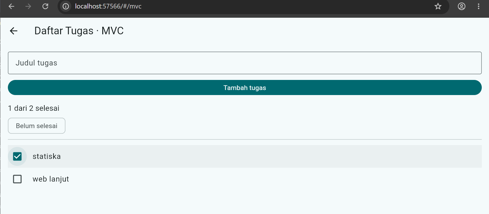
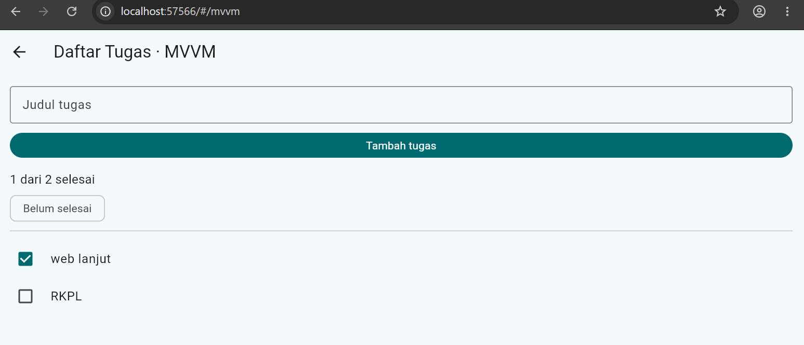
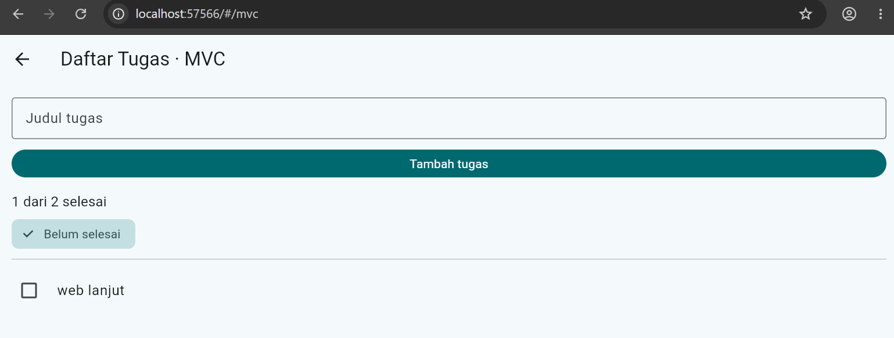
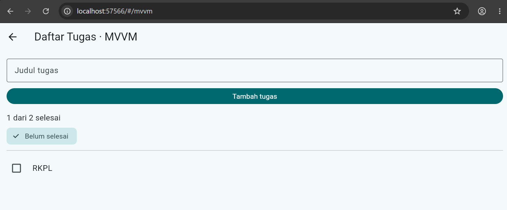

# Starter Praktikum Arsitektur Tugas

Jalankan dari folder yang berisi pubspec.yaml dengan Flutter 3.29.2.

    flutter pub get
    flutter test
    flutter run -d chrome

Starter memuat model, repository dalam memori, form, menu, dan smoke test. Kerjakan versi MVC, versi MVVM, dan test tambahan dengan mengikuti PDF praktikum. Layar awal kedua versi berisi petunjuk untuk mulai mengimplementasikan.

## Dokumentasi Praktikum

| Kondisi | Implementasi MVC | Implementasi MVVM |
| :---: | :---: | :---: |
| **Filter Mati** |  |  |
| **Filter Aktif** |  |  |

Dokumentasi lengkap dan analisis perbandingan arsitektur dapat dilihat pada [LAPORAN.md](LAPORAN.md).
